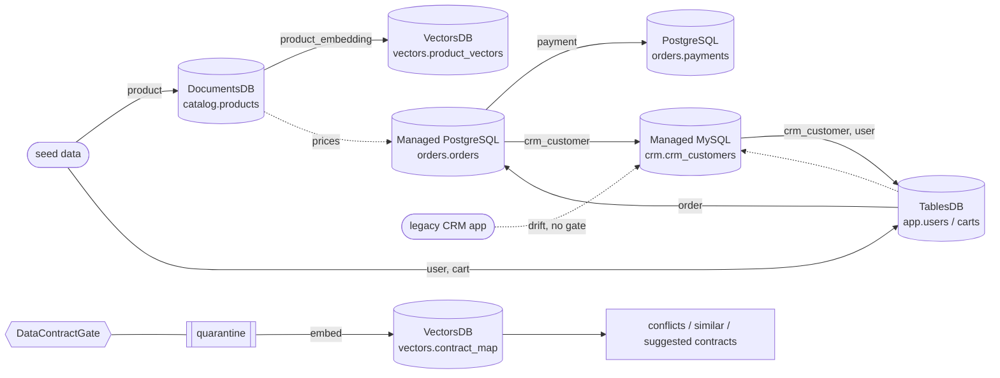

# nmb-appwrite-five

**One data contract, enforced across all five Appwrite database types.**

A small demo storefront that keeps real app data in TablesDB, DocumentsDB,
VectorsDB, Managed PostgreSQL and Managed MySQL. [DataContractGate](https://github.com/nightmoose/contractgate)
enforces a data contract at every edge where data moves between stores.

| Store (database id) | What lives there | Contract(s) |
| --- | --- | --- |
| **DocumentsDB** (`catalog`) | product catalog (schemaless docs) | `product` |
| **TablesDB** (`app`) | users, carts, settings | `user`, `cart` |
| **VectorsDB** (`vectors`) | product embeddings + the *contract relationship map* | `product_embedding`, `contract_map_entry` |
| **Managed PostgreSQL** (`orders`) | orders, payments | `order`, `payment` |
| **Managed MySQL** (`crm`) | a legacy CRM that drifts | `crm_customer` |

## Why five stores

Real apps rarely use just one database. Each store type has a job here:
documents suit a catalog that changes shape, tables suit users and carts,
SQL engines suit money and legacy systems, and vectors suit search. Each
boundary is also a place where definitions drift apart. Running all five
inside one Appwrite project lets one contract layer sit at every boundary.

## Architecture



Every solid arrow is one gated edge (labelled with its contract). Nine edges
in total.

Passing records are written to the target store. Failing records never
land there. They go to quarantine, and both the failures and the
contracts are embedded into VectorsDB. That **contract relationship map**
can:

- find contracts similar to a given one (`order` → `payment`, `cart`),
- flag **conflicts**: the same concept with different rules (e.g. `cart.status` vs `order.status` enums),
- explain a quarantined record by its nearest contracts, and
- **suggest a contract for a new feed** from a few sample records. It borrows rules from the nearest contracts, e.g. a `refund` feed inherits the `order_id` pattern from `order`.

## Quickstart (local, no Appwrite account needed)

```bash
python -m venv .venv && . .venv/bin/activate
pip install -e ".[dev]"
python -m nmb_five demo     # end-to-end demo, JSON to stdout
python -m nmb_five serve    # storefront UI on http://127.0.0.1:8000
pytest -q
```

Local mode uses in-memory stand-ins for TablesDB, DocumentsDB, and
VectorsDB, sqlite for the two SQL engines, and a deterministic hashed
embedder.

## Run it on Appwrite Cloud

0. `pip install -e ".[appwrite]"`
1. Create one project with a TablesDB, a DocumentsDB, a VectorsDB, a PostgreSQL and a MySQL database (see `docs/appwrite-notes.md` for plan requirements).
2. Copy `.env.example` to `.env` and fill it in. Native PostgreSQL and MySQL are reached through Appwrite's SQL API over HTTPS by default (`APPWRITE_SQL_TRANSPORT=api`). Set `driver` to use the DSN / host instead.
3. `python -m nmb_five.provision` creates the TablesDB tables `users`, `carts`, `settings`, the DocumentsDB collection `products`, and the VectorsDB collections `product_vectors` and `contract_map` (768 dimensions, `hnsw_cosine` index on `embeddings`). It is idempotent.
4. `python -m nmb_five demo --mode appwrite` or `python -m nmb_five serve --mode appwrite`
5. `NMB_LIVE=1 pytest -q` also runs the live smoke test against all five stores.

## Storefront UI

`python -m nmb_five serve` shows, on one page: the five stores with live row
counts (click a table to preview rows), every gated edge with pass and
quarantine counts, a **live contract check** box (paste a record and check it
with DataContractGate; failures land in quarantine and get embedded into the
map), the quarantine panel, the VectorsDB contract map (conflicts, nearest
contracts, semantic product search), and the contract suggested for a new
`refund` feed. See `docs/demo-script.md` for the video walkthrough.

## Public demo on Appwrite (Sites + Functions)

The hosted demo runs entirely on Appwrite:

- **Appwrite Site** `nmb-storefront`: the static page in `nmb_five/static`, plus a generated `config.js` that points at the API.
- **Appwrite Function** `nmb-storefront-api` (Python): `functions/storefront/src/main.py` wraps `nmb_five/cloud_api.py`. Store cards and row previews are read live from all five stores. The contract map, explanations, the suggested contract, and product search query VectorsDB live and never write to it. The nine edges and their quarantine are replayed in memory from the same seed data the live pipeline wrote.
- **Public live check is sandboxed.** A checked record is only written to the TablesDB table `public_checks`, never to the five demo stores. That table is rate limited (6 checks per minute per client, 60 per minute overall), capped to the last 200 rows, and records are limited to 4 KB. There is no reset or delete endpoint.
- **CORS:** the function answers browsers only from the origins in `ALLOWED_ORIGINS` (the site's domain).
- **Credentials** are function environment variables set through the Appwrite API by the deploy script. They are never in the repo or the bundle.

Deploy:

1. Give the API key the `functions.read`, `functions.write`, `sites.read`, `sites.write`, `rules.read` and `rules.write` scopes, in addition to the database and embeddings scopes the demo already uses.
2. `python -m nmb_five.provision` (creates `public_checks` among the rest).
3. `python scripts/deploy_appwrite.py`. It bundles `nmb_five`, `contracts/` and the DataContractGate SDK into the function, sets the variables, adds function and site domains, deploys the site, and prints both URLs. Set `NMB_FUNCTION_DOMAIN` / `NMB_SITE_DOMAIN` to pick the domains.

## Verified live

Tested on 2026-10-21 against Appwrite Cloud (nyc):

- `provision`, `demo --mode appwrite`, and the UI in `--mode appwrite` all ran against all five stores.
- `NMB_LIVE=1 pytest -q`: the live smoke test passes. The first SQL call to each native database is retried with backoff to ride out hibernation wake-up; any failed attempt is reported as a pytest warning with the real exception.
- PostgreSQL and MySQL go through Appwrite's SQL API over HTTPS. Direct driver ports were not reachable from our build network, so the driver path has not been verified live.
- VectorsDB vector queries must use the POST query endpoint. A 768-float vector in a GET URL fails with `URI Too Long`.
- Native databases hibernate after 15 idle minutes, so the first call after a pause takes a few seconds.

Details and sources: `docs/appwrite-notes.md`.

## Layout

```
contracts/                DataContractGate YAML contracts
nmb_five/gate.py          DataContractGate wrapper (pass / quarantine)
nmb_five/connectors/      Connector interface, local stand-ins, Appwrite connectors
nmb_five/sync.py          sync jobs between the five stores
nmb_five/contract_map.py  VectorsDB contract relationship map
nmb_five/seed.py          demo data (with deliberate bad rows)
nmb_five/web.py           local storefront UI server (stdlib) + static/index.html
nmb_five/cloud_api.py     public API used by the Appwrite Function (sandboxed checks)
functions/storefront/     Appwrite Function entrypoint
scripts/deploy_appwrite.py  deploys the Function and the Site
tests/                    pytest suite
docs/appwrite-notes.md    verified Appwrite facts with sources
docs/demo-script.md       timed video script
```

## Tech stack

Python 3.10+, the [DataContractGate](https://github.com/nightmoose/contractgate) Python SDK (MIT),
`appwrite` Python SDK, `psycopg`,
`PyMySQL`, `PyYAML`, `pytest`.

## License

MIT
